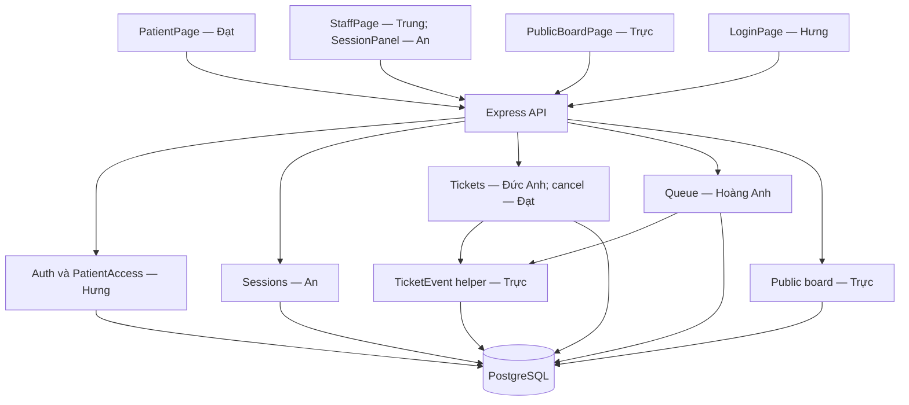

# Kiến trúc MediQueue

Phiên bản 1.0 ban hành ngày 01/11/2026 — **ÁP DỤNG TRIỂN KHAI**. Thành viên thực hiện theo tài liệu; thay đổi dùng chung phải được An duyệt. Tiến độ API được xác minh riêng qua mã nguồn và kiểm thử.

React → API Express `/api/v1` → các service/repository → PostgreSQL. Một backend gồm nhiều mô đun, cùng pool/transaction; không tách thành microservice.



Audit helper nhận cùng giao dịch từ nghiệp vụ, không tự commit. Mỗi máy có DB thử riêng, cùng migration/seed; môi trường tích hợp dùng DB riêng được xác định rõ.

## Quản lý phiên trong Sprint 2

`SessionPanel` nằm trong `StaffPage`, gọi `session.api.js` qua `http.js` chung. StaffPage truyền bản đọc phiên định kỳ vào `currentSession`; callback `onSessionChange` tải lại phiên và hàng đợi sau thao tác. API kiểm tra quyền STAFF và lấy người thao tác từ phiên đăng nhập phía server.

```mermaid
sequenceDiagram
  participant UI as SessionPanel
  participant API as Session API
  participant TX as Session service / transaction
  participant DB as PostgreSQL
  UI->>API: POST /sessions/{id}/stop hoặc /close
  API->>API: authenticate, requireStaff, kiểm tra đầu vào
  API->>TX: actor và sessionId
  TX->>DB: BEGIN, SELECT QueueSession FOR UPDATE
  alt Close từ STOPPED
    TX->>DB: Kiểm tra WAITING/CALLED/REGISTERING
  end
  alt Trạng thái và điều kiện hợp lệ
    TX->>DB: UPDATE trạng thái, người, thời điểm; COMMIT
    TX-->>API: Session DTO
    API-->>UI: 200 với trạng thái đã lưu
  else Bị từ chối
    TX->>DB: ROLLBACK
    TX-->>API: Lỗi nghiệp vụ
    API-->>UI: 409 và mã lỗi
  end
  UI->>API: Đọc lại phiên hiện tại
```

Các thao tác ghi của tickets/queue khóa cùng hàng QueueSession trước Ticket. Vì vậy cấp số/ngừng và hủy/đóng được tuần tự hóa theo phiên, giữ khóa đến khi commit hoặc rollback. Stop trên STOPPED và close trên CLOSED trả trạng thái đã lưu, giữ người và thời điểm audit ban đầu.

OPEN → STOPPED chặn cấp số mới và giữ khả năng xử lý phiếu cũ. STOPPED → CLOSED chỉ khi hết phiếu hoạt động. Đổi trạng thái phiên được ghi ở các cột audit QueueSession. [Hợp đồng phiên](../api/openapi.yaml), [mô đun phiên](../modules/sessions.md), [AC](../requirements/sessions.md).

## Nguồn thống nhất

- [Toàn bộ thiết kế và quy định triển khai](shared-design-v1.0.md).
- [Dữ liệu và ràng buộc](erd.md).
- [Vòng đời](ticket-state-machine.md).
- [Hợp đồng OpenAPI](../api/openapi.yaml).
- [Phạm vi và user stories](../requirements/scope.md).

Xác thực dùng cookie server session, PostgreSQL store, 8 giờ tuyệt đối. Hưng/Trực ghi rõ thư viện/phiên bản và DDL store; store là bảng kỹ thuật, không phải QueueSession. T ghi vắng là 60 giây; Hoàng Anh/Trung triển khai nhất quán giữa API và UI. Giữ 20 giờ/người/sprint; nếu task bị chặn hoặc vượt dự kiến phải báo An để xử lý.
