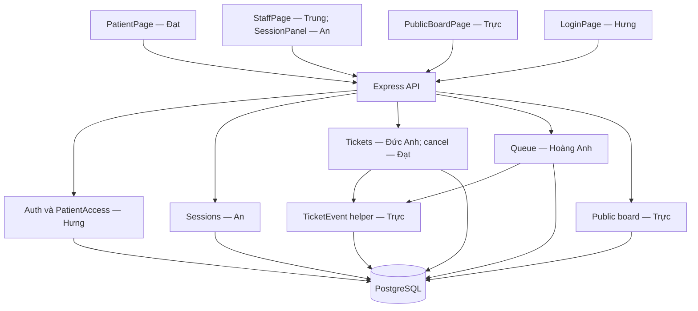

# Kiến trúc MediQueue

Phiên bản 1.0 ban hành ngày 01/11/2026 — **ÁP DỤNG TRIỂN KHAI**. Thành viên thực hiện theo tài liệu; thay đổi dùng chung phải được An duyệt. Tiến độ API được xác minh riêng qua mã nguồn và kiểm thử.

React → API Express `/api/v1` → các service/repository → PostgreSQL. Một backend gồm nhiều mô đun, cùng pool/transaction; không tách thành microservice.

Audit helper nhận cùng giao dịch từ nghiệp vụ, không tự commit. Mỗi máy có DB thử riêng, cùng migration/seed; môi trường tích hợp dùng DB riêng được xác định rõ.

## Nguồn thống nhất

- [Toàn bộ thiết kế và quy định triển khai](shared-design-v1.0.md).
- [Dữ liệu và ràng buộc](erd.md).
- [Vòng đời](ticket-state-machine.md).
- [Hợp đồng OpenAPI](../api/openapi.yaml).
- [Phạm vi và user stories](../requirements/scope.md).

Xác thực dùng cookie server session, PostgreSQL store, 8 giờ tuyệt đối. Hưng/Trực ghi rõ thư viện/phiên bản và DDL store; store là bảng kỹ thuật, không phải QueueSession. T ghi vắng là 60 giây; Hoàng Anh/Trung triển khai nhất quán giữa API và UI. Giữ 20 giờ/người/sprint; nếu task bị chặn hoặc vượt dự kiến phải báo An để xử lý.
