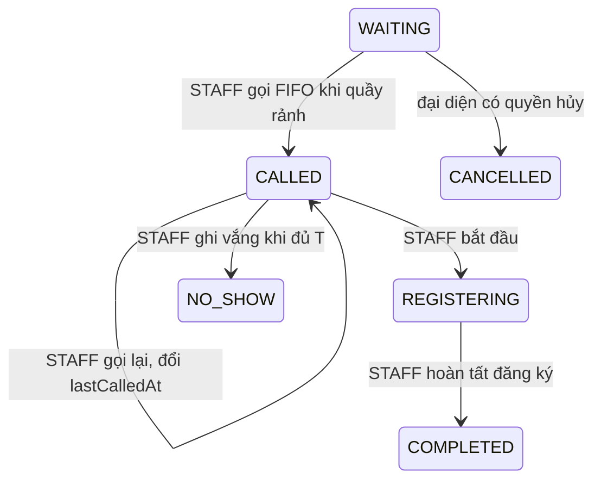
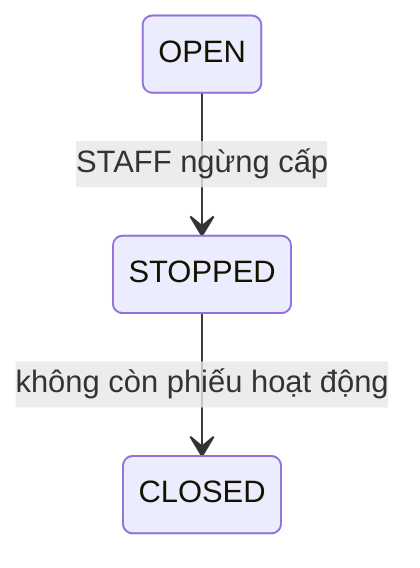

# Vòng đời phiên và phiếu

Phiên bản 1.0 ban hành ngày 01/11/2026 — **ÁP DỤNG TRIỂN KHAI**. Hoàng Anh chủ trì quy tắc Ticket, An chủ trì QueueSession, Đạt chủ trì hủy; các chủ phần triển khai theo quy định dưới đây.

Phiếu hoạt động: WAITING, CALLED, REGISTERING. Quầy bận: CALLED hoặc REGISTERING. Trạng thái cuối: COMPLETED, CANCELLED, NO_SHOW; không đưa phiếu cuối trở lại WAITING. Người quay lại lấy phiếu mới/requestId mới nếu phiên vẫn OPEN và không còn phiếu hoạt động.

Chỉ đóng từ STOPPED; không mở lại STOPPED. Stop STOPPED hoặc close CLOSED trả nguyên phiên 200; stop CLOSED/close OPEN trả 409 INVALID_STATE. Chỉ mở phiên mới khi không còn OPEN/STOPPED.

## Ghi vắng và gọi lại

T = 60 giây, NO_SHOW_TIMEOUT_SECONDS chung. Server quyết định sau kiểm tra/khóa trạng thái; tại đúng T được phép, trước T trả NO_SHOW_TOO_EARLY. Không tự động đánh vắng. Gọi lại giữ ticketId/số, cập nhật lastCalledAt và ghi RECALLED CALLED→CALLED; T bắt đầu lại. Test dùng thời gian kiểm soát được.

## Tính nguyên tử

Khóa QueueSession trước Ticket; kiểm tra lại dữ liệu sau khi chờ khóa; thay đổi Ticket và TicketEvent cùng giao dịch. ISSUED, CALLED, RECALLED, STARTED, COMPLETED, CANCELLED, NO_SHOW là các action. Phiên dùng trường người/thời điểm, không sinh TicketEvent thiếu phiếu.
